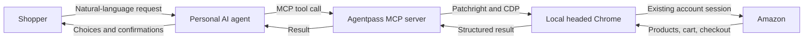
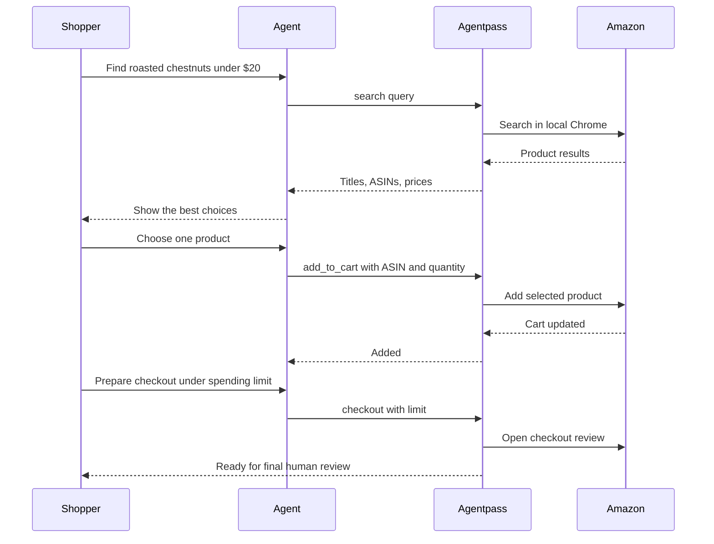
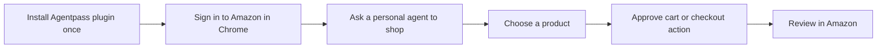

# agentpass

> Shop the web with your personal AI agent and your own browser.

[](https://www.python.org/)
[](LICENSE)

Agentpass is an open-source browser runtime for personal shopping agents. It
gives an agent a real, headed Chrome session with a persistent local profile,
then exposes a small set of shopping actions over MCP.

The goal is simple:

> “Use Agentpass to find roasted chestnuts under $20, show me the best three,
> and add the one I choose to my Amazon cart.”

Your login stays in your Chrome profile. The agent gets structured tools. Cart
and checkout actions stay visible and confirmation-gated.

## Why Agentpass

Browser agents often fail on shopping sites for reasons that have little to do
with reasoning. A site can receive one browser identity in HTTP headers and a
different identity from JavaScript Client Hints. Fresh disposable profiles also
lose the account session, delivery location, cart, and preferences that make a
personal shopping workflow useful.

Agentpass solves the browser-runtime layer:

- Runs the user's installed Chrome in headed mode.
- Reuses a local profile instead of a disposable browser.
- Keeps HTTP Chrome headers and `navigator.userAgentData` consistent.
- Detects challenge and error pages and saves a diagnostic screenshot.
- Exposes focused MCP tools instead of giving the model arbitrary browser
  access.
- Stops before final order placement in the current release.

## How it works



Agentpass currently exposes three tools:

| Tool | What it does | Changes state |
| --- | --- | --- |
| `search(query)` | Returns product title, ASIN, and displayed price. | No |
| `add_to_cart(asin, qty)` | Adds an exact product and quantity to the cart. | Yes |
| `checkout(confirm_under)` | Opens checkout only when the subtotal is below the supplied ceiling. | Yes |

## Shopping flow



## The intended user experience

The project is moving toward a packaged desktop plugin:



For the end user, that means no Python setup, terminal commands, API keys,
public server, or manually configured tunnel. The local MCP runtime ships with
the desktop plugin and runs on the user's machine, where it can use that user's
Chrome profile.

The repository is currently the working Python prototype. Packaging the runtime
as a self-contained desktop plugin is the next distribution milestone.

## Install for development

Requirements:

- Python 3.11 or newer
- Google Chrome
- Windows, macOS, or Linux desktop session

```bash
git clone https://github.com/EnesYilmazcode/agentpass.git
cd agentpass
python -m venv .venv
```

Activate the environment:

```bash
# macOS or Linux
source .venv/bin/activate

# Windows PowerShell
.venv\Scripts\Activate.ps1
```

Install Agentpass and its tests:

```bash
pip install -e ".[test]"
```

## Sign in once

```bash
agentpass-login
```

Agentpass opens its persistent Chrome profile. Sign in to Amazon directly in
that window, then return to the terminal and press Enter. Agentpass never asks
for or receives your Amazon password.

The default profile lives in `.profile/` and is excluded from Git. Choose a
different location with `AGENTPASS_PROFILE`:

```powershell
$env:AGENTPASS_PROFILE = "C:\path\to\agentpass-profile"
```

## Run the MCP server

```bash
agentpass
```

The server uses stdio transport and advertises accurate MCP safety annotations:

- `search` is read-only and open-world.
- `add_to_cart` and `checkout` are write actions.
- `checkout` prepares the Amazon review page but does not place the order.

## Use the browser harness directly

```python
from agentpass.browser import launch

context = await launch()
page = context.pages[0]
await page.goto("https://www.amazon.com")

# Work with the signed-in local browser.

await context.close()
```

## The Client Hints fix

Changing request headers alone does not update JavaScript's view of the browser.
Agentpass applies a CDP `Network.setUserAgentOverride` with a complete
`userAgentMetadata` payload:

```python
brands = await page.evaluate(
    "() => navigator.userAgentData.brands.map(b => b.brand).join(',')"
)

assert "HeadlessChrome" not in brands
assert "Chrome" in brands
```

## Tests

Run the standard suite:

```bash
pytest -v
```

The suite includes offline unit tests and live checks against neutral browser
fingerprint endpoints. The Amazon smoke test is opt-in because it touches a live
storefront and can be rate-limited:

```powershell
$env:AGENTPASS_RUN_AMAZON = "1"
pytest -v tests\test_amazon_live.py
```

## Roadmap

- [x] Persistent headed Chrome context
- [x] Consistent HTTP and JavaScript Chrome identity
- [x] Product search, add-to-cart, and checkout-preparation tools
- [x] MCP read/write annotations and spending ceiling
- [x] Challenge diagnostics and live fingerprint tests
- [ ] Package a self-contained local runtime for desktop plugin installation
- [ ] Add a product-comparison and confirmation UI
- [ ] Add account, cart-inspection, seller, delivery, and variant tools
- [ ] Add serialized access to the persistent browser profile
- [ ] Evaluate standards-based agent identification separately from browser
      compatibility
- [ ] Design final order placement with a fresh total, exact cart snapshot,
      explicit approval, and duplicate-order protection

## Scope and safety

Agentpass is designed for a shopper operating their own account and browser.
Write actions should remain confirmation-gated. The current release intentionally
does not click Amazon's final order button.

Agentpass is not affiliated with or endorsed by Amazon. Storefront markup and
behavior can change, and live automation may encounter account checks, regional
differences, or temporary rate limits.

## License

[MIT](LICENSE)
